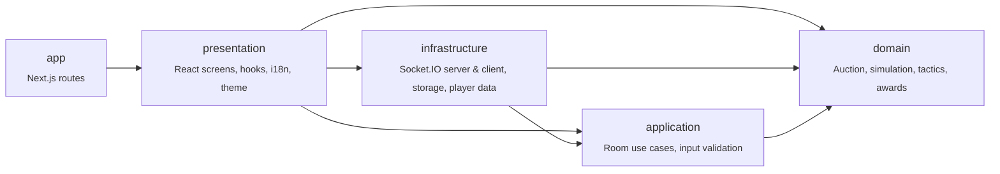

<div align="center">

**English** · [Português](README.pt-BR.md)

# 20 Bucks Each

Leilão de jogadores da NBA: cada técnico tem $20 pra montar o quinteto mais forte.

**Versão atual:** salas multiplayer (públicas e privadas) ou treino contra bots, leilão ao vivo e campeonato simulado (temporada regular, playoffs e prêmios).


## Estrutura

```
server/index.ts        Servidor das salas (Socket.IO): só repassa mensagens
src/
  app/                 Rotas do Next.js (layout, página inicial, CSS global)
  components/          Telas: SetupScreen, AuctionScreen, ResultsScreen, mascote
  hooks/useAuction.ts  Liga o motor ao React (relógio, lances, passar)
  i18n/                Traduções PT/EN/ES (messages.ts) e o provider do idioma
  theme/               Tema claro/escuro (variáveis em app/globals.css)
  data/players.ts      Base de jogadores (PROVISÓRIA: ratings estimados)
  lib/auction/         Motor do leilão em TypeScript puro, sem React
    types.ts           Tipos (Player, Coach, Lot, AuctionState…)
    rules.ts           Regras: lance máximo, vagas por posição, força do time
    bots.ts            Como os bots avaliam e dão lance
    pool.ts            Sorteio do pool limitado de jogadores do leilão
    engine.ts          createAuction, placeBid, passLot, tick
    engine.test.ts     Testes
  lib/sim/             Simulação do campeonato (TypeScript puro)
    probability.ts     Chance de vitória: 65% força + 35% sorte (SKILL_WEIGHT)
    strength.ts        Força do time (titulares, fora de posição, banco)
    game.ts            Um jogo: placar, quartos e estatísticas dos jogadores
    tournament.ts      Tabela, temporada, playoffs (séries com chaveamento) e MVP
    sim.test.ts        Testes
  lib/rooms/           Salas (TypeScript puro, testado)
    service.ts         Criar/entrar/sair, configurações, início, modo ausente, bots substitutos
    validate.ts        Confere tudo que chega do navegador antes de usar
    events.ts          Nomes dos eventos entre site e servidor
  components/tournament/  Telas da temporada, chave dos playoffs e prêmios
  components/room/     Sala de espera, configurações da sala, aviso de ausente
  app/sala/[code]/     Página de uma sala (/sala/K7Q2M)
```

## Salas e modo ausente

- **Pública:** aparece na lista da tela inicial. **Privada:** só entra quem tem o link ou o código.
- O dono da sala pode mudar visibilidade, limite de técnicos e regras antes de começar (botão Configurações). Mudar as regras tira o "pronto" de todo mundo. Se o dono sair, outro jogador vira dono.
- Todo mundo precisa clicar em **Estou pronto** antes do dono conseguir começar.
- O dono pode **expulsar** alguém da sala de espera; quem foi expulso não consegue voltar naquela sala.
- Vagas vazias viram bots na hora de começar (se a opção estiver ligada).
- **Ausente:** 45s sem mexer (mouse, toque ou teclado), ou cair a conexão, e um bot assume (`AWAY_AFTER_MS` em `lib/rooms/service.ts`). Qualquer movimento ou o botão "Voltar a jogar" devolve o controle.
  - Na sala de espera, o bot marca você como pronto. Se o **dono** estiver ausente e todos os outros prontos, o bot dele começa a partida.
  - No leilão, o bot dá lances por você.
  - Na tática, o bot escolhe a que mais combina com o seu elenco.
- Quem **sai** da partida é substituído por um bot de vez.
- Recarregar a página não tira você da sala: o navegador guarda um token secreto que devolve sua vaga.

## Tática e escalação

Na tela de tática também dá para mudar a **escalação**: cada posição tem uma lista com quem pode jogar ali (posição natural ou vizinha), e escolher alguém troca os dois de lugar, inclusive com o banco. Jogador fora de posição aparece com **−3** (`lib/auction/lineup.ts`).


Depois do leilão cada técnico escolhe **estilo de ataque** (Equilibrado, Chuva de 3, Garrafão) e **ritmo** (Lento, Normal, Rápido). Nas salas são 60s (`TACTICS_MS`); se o tempo acabar, vale o que estiver marcado.

- Cada estilo olha um ponto do elenco (média dos titulares): Chuva de 3 → arremesso; Garrafão → finalização + rebote; Rápido → atletismo; Lento → armação. Equilibrado e Normal não mudam nada.
- Acima da média da liga, o estilo soma força; abaixo, tira. Cada parte vai de −3 a +3, e o total fica entre −4 e +4 (`lib/sim/tactics.ts`).
- O ritmo também muda o placar: jogos rápidos têm mais pontos, lentos têm menos.
- A tela mostra o encaixe de cada opção (de "Encaixe perfeito" até "Não combina") e a força final do time. As táticas dos outros ficam secretas até os jogos.
- Os bots sempre escolhem a tática que mais combina com o elenco deles.

## Publicar online

O site e o servidor das salas rodam em lugares diferentes:

1. **Servidor das salas:** qualquer hospedagem que rode Node.js o tempo todo (Render, Railway, Fly.io…). Comando de instalação `npm install`, comando de início `npm run start:server`, e a variável `CLIENT_ORIGIN` com o endereço do site (ex.: `https://20-bucks-each.vercel.app`).
2. **Site na Vercel:** adicione a variável `NEXT_PUBLIC_SERVER_URL` com o endereço do servidor (ex.: `https://20-bucks-each-server.onrender.com`).

Sem o servidor, o site continua funcionando no modo treino contra bots.

O motor (`lib/auction`) é puro: recebe um estado e devolve um estado novo, sem mexer em nada fora.
Por isso dá pra testar sem abrir o navegador, e na etapa do multiplayer o mesmo código vai rodar no servidor.

## Regras implementadas

- Todo mundo começa com $20 e precisa fechar PG, SG, SF, PF e C (+2 reservas, se ativado).
- Cada leilão sorteia um pool limitado: vagas de todos + 30% (`POOL_FACTOR` em `lib/auction/pool.ts`), com cada posição garantida.
- Os jogadores vão a leilão um por um, em ordem aleatória, sem mostrar quem vem depois.
- Cada jogador tem um relógio (10, 15 ou 20s) que **não reinicia** com lances. Um lance nos últimos 3s volta o relógio para 3s (`BID_EXTENSION_SECONDS` em `lib/auction/rules.ts`). Quando zera, o maior lance leva.
- Lance máximo = saldo − $1 por vaga que ainda falta (ninguém fica sem dinheiro pra completar o time).
- O jogador só pode ser comprado por quem tem vaga para ele: na posição dele, numa posição vizinha (PG↔SG↔SF↔PF↔C) ou no banco. Fora da posição natural ele perde 3 de força (`lib/auction/positions.ts`).
- Quem não tem vaga para a posição do jogador (nem numa vizinha), ou não tem dinheiro para o próximo lance, passa automaticamente. Um aviso embaixo da tela explica por quê.
- O lote fecha na hora quando todo mundo passou, ou quando alguém dá um lance que ninguém mais consegue cobrir.
- Se no fim sobrar vaga aberta, ela é preenchida de graça com o **pior** jogador que sobrou (passar esperando craque é arriscado).

## Como a simulação funciona

- **Força do time:** média dos titulares, −3 por jogador fora de posição, mais um bônus pequeno pelo banco.
- **Chance de vitória:** `65% × curva da diferença de força + 35% × 50%`. Times iguais = 50%; 90 × 85 ≈ 72%; o azarão sempre tem pelo menos ~17%.
- **Placar:** a margem de pontos é sorteada de uma curva normal ajustada para bater com essa chance; os pontos são divididos em quartos (com prorrogação se empatar) e entre os jogadores pelos atributos.
- **Temporada:** todos contra todos (ida e volta até 6 times). Desempate: vitórias, saldo, pontos feitos.
- **Playoffs:** chave padrão (1×8, 4×5…), folga para os melhores quando o número não fecha, séries de 1, 3 ou 7 jogos (mando 2-2-1-1-1).
- **MVP:** maior média de pontos + 1,2 × rebotes + 1,5 × assistências na temporada.

## Próximas etapas

2. Ajustes do leilão a partir dos seus testes
3. ~~Simulação: temporada regular + playoffs~~ ✅
4. ~~Multiplayer em tempo real (salas com link de convite)~~ ✅
5. Base de jogadores real e polimento visual
**A real-time NBA player auction game. Everyone gets $20 to build the strongest starting five.**

Bid on players live with friends (or bots), set your lineup and tactics, then watch a simulated season and playoffs decide who built the best team.


</div>

<!--
  Screenshots: add images to docs/ and reference them here, e.g.
  
-->

## About

Inspired by the "$20 each" auction videos from American sports creators and by the Brazilian game [100pracada](https://100pracada.thefenomeno.com/). Each coach starts with $20 and must fill PG, SG, SF, PF and C by bidding on players one at a time. Spend everything on one superstar, or spread it out? Then the simulation decides.

## Features

**Multiplayer**
- Public rooms, listed live on the home page, and private rooms shared by link or code (2–16 coaches).
- Host controls: change rules and visibility, kick players, start the match once everyone is ready.
- Empty seats filled with bots. A player who leaves is replaced by a bot for good.
- **Away mode**: after 45 s without input (or a dropped connection) a bot takes over. In the lobby it marks you ready; in the auction it bids for you; in the tactics phase it picks the tactic that best fits your roster. Any input gives control back.
- Reloading the page keeps your seat: the browser holds a secret token, never shared with other players.

**Auction**
- One clock per player that never resets: a bid in the last 3 seconds only extends it back to 3.
- Max bid is enforced so nobody gets stuck without $1 for each open slot.
- A limited, random player pool (open slots + 30%, every position covered). Waiting for a star is a gamble, because whoever ends up with an open slot gets the worst leftover player.
- Automatic passes, with an on-screen reason, when you have no slot or not enough money. A lot closes as soon as nobody can cover the top bid.
- Optional **hidden ratings** mode: no overall or attributes, only your NBA knowledge.
- Players can line up at a neighboring position (PG↔SG↔SF↔PF↔C) with a strength penalty.

**Simulation**
- Each game is 65% team strength and 35% luck, so upsets happen but the better team is still the favorite.
- Realistic box scores: quarter-by-quarter scores, overtime, and points, rebounds and assists spread among players by their attributes.
- Round-robin regular season, standard NBA-style bracket with byes, best-of-1/3/7 series with 2-2-1-1-1 home court.
- **Tactics**: offensive style (balanced, threes, paint) and pace (slow, normal, fast). Each one helps or hurts depending on how your roster fits it. Tactics stay secret until the games are played.
- **Lineup editor**: move players between slots and the bench.
- Awards: champion, MVP, best GM (most value per dollar) and biggest buy.

**UI**
- Portuguese, English and Spanish, auto-detected and switchable.
- Light and dark themes with no flash on load.
- Responsive and accessible: semantic buttons and forms, labels, live regions for timers and scores, focus-managed dialogs.

## Architecture

The code follows **Clean Architecture**. Dependencies only point inward, and an [automated test](src/architecture.test.ts) fails the test suite if any file breaks that rule.



| Layer | What lives there | Depends on |
| --- | --- | --- |
| `domain` | Auction engine, bots, positions and lineup rules, game and tournament simulation, tactics, awards. Pure TypeScript, no packages, no I/O. | nothing |
| `application` | `RoomService`: rooms, ready/kick, away mode, phases, plus validation of untrusted input. Clock, randomness and the player database are injected. | domain |
| `infrastructure` | Socket.IO server adapter, socket client, browser storage, player data. | application, domain |
| `presentation` | React screens and hooks, translations, theme. | everything inward |
| `app` | Next.js routing only. | presentation |

### Design decisions

- **A pure, deterministic engine.** Every auction and simulation function takes a state and returns a new one. The random generator's seed lives in the state, so the same seed always replays the same match. That makes the rules easy to test and lets the exact same code run in the browser (solo mode) and on the server (rooms).
- **The server has the final say.** The server owns the clock, the bots and the rules. Clients only send intentions (bid, pass, swap) and receive views. Every payload is validated before use.
- **Hidden information stays hidden.** Clients never receive the upcoming player queue, the RNG seed, other coaches' tactics or other players' tokens. Tests check this.
- **Probabilities you can reason about.** The win chance blends a logistic curve on the rating gap (65%) with a coin flip (35%). The score margin is sampled from a normal distribution whose mean comes from the inverse normal CDF of that chance, so the box score always agrees with the odds. A 4,000-game test confirms the observed win rate matches the formula.
- **Tactics balanced against real data.** Fit baselines are the median team attributes from simulated auctions, so each style helps about half of the rosters and hurts the other half.

## Getting started

Requirements: Node.js 20.9+

```bash
npm install
npm run dev
```

`npm run dev` starts the site (http://localhost:3000) and the room server (port 3001) together. To try multiplayer locally, open the site in a normal and a private window, create a room in one and join from the other.

| Script | Description |
| --- | --- |
| `npm run dev` | Site + room server with hot reload |
| `npm test` | Unit, simulation, room and architecture tests |
| `npm run typecheck` | TypeScript strict check |
| `npm run build` | Production build of the site |
| `npm run start:server` | Room server in production |

### Deploying

The site and the room server run separately:

1. **Room server**: any host that keeps a Node.js process running (Render, Railway, Fly.io…). Start command `npm run start:server`, with `CLIENT_ORIGIN` set to the site URL.
2. **Site** on Vercel, with `NEXT_PUBLIC_SERVER_URL` set to the room server URL.

Without the server, the site still works in solo mode against bots.

## Project structure

```
server/index.ts              Composition root of the room server
src/
  domain/
    auction/                 Engine, rules, bots, pool, positions, lineup
    simulation/              Win probability, games, tournament, tactics, team strength
    awards/                  Best GM, biggest buy, rankings
    shared/rng.ts            Seeded random generator
  application/rooms/         RoomService (use cases), DTOs, input validation
  infrastructure/
    server/                  Socket.IO adapter
    realtime/                Socket client and event names
    storage/                 Browser identity (token, name)
    data/players.ts          Player database
  presentation/
    components/              Screens: home, auction, tactics, tournament, rooms
    hooks/                   useAuction, useRoom, usePublicRooms, useConnection
    i18n/                    PT / EN / ES messages
    theme/                   Light / dark theme
  app/                       Next.js routes (/ and /sala/[code])
  architecture.test.ts       Enforces the dependency rule
```

## Roadmap

- Real player database with photos and ratings derived from real stats
- Bots that optimize their own lineup after the auction
- More sports (the engine is not tied to basketball positions beyond `domain/auction/positions.ts`)
- Persistent rooms and match history

## Disclaimer

A fan project made for learning. Not affiliated with the NBA, its teams or 2K. Player ratings in `src/infrastructure/data/players.ts` are rough placeholder estimates, not official numbers.

---

Built by [cardinalipedro](https://github.com/cardinalipedro).
