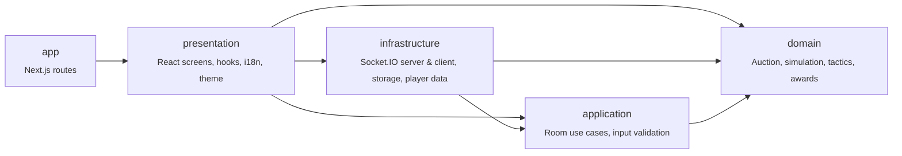

<div align="center">

**English** · [Português](README.pt-BR.md)

# 20 Bucks Each

**A real-time NBA player auction game. Everyone gets $20 to build the strongest starting five.**

### [▶ Play it live](https://20-bucks-each.vercel.app)


</div>

<!--
  Screenshots: add images to docs/ and reference them here, e.g.
  
-->

## What it is

Coaches join a room, each one with $20. NBA players go up for auction one at a time, and everyone bids live to fill PG, SG, SF, PF and C. After the auction, each coach picks a lineup and a tactic, and a simulated season and playoffs decide who built the best team. Play with friends in public or private rooms, or practice alone against bots.

## Why I built it

Two things inspired it. One is a video format from American sports creators: everyone gets "$20 each", auctions off players and argues about who built the best team. The other is [100pracada](https://100pracada.thefenomeno.com/), a Brazilian browser game that does the same with football. I wanted the NBA version, something to play with friends, and a real project to learn from: real-time multiplayer, game logic, probability and deployment, not just another CRUD app.

## How it was built, step by step

**1. Design before code.** Before writing any code, I mocked up the three main screens on a design canvas: create room, live auction, season and playoffs. That settled the visual identity: dark green, the color of a dollar bill, with a $20 note as the central motif. The mascot started as a bear and became an angry **buck** (a male deer), because "bucks" means both dollars and male deer. It is an original drawing, deliberately unlike any NBA team logo.

**2. An auction engine with no UI.** The first code was the auction rules in plain TypeScript: bids, a max-bid rule so nobody runs out of money for their open slots, positions, and bots that value players by rating, budget and roster needs. Every function takes a state and returns a new one, with a seeded random generator, so whole auctions could be tested before any screen existed.

**3. Playtesting changed the rules.** Each version was played and adjusted:
- Showing the upcoming players killed the tension, so the queue became hidden.
- People passed on everyone while waiting for a star. Now each auction draws a limited pool, and whoever ends with an open slot gets the *worst* leftover player.
- The clock no longer resets on every bid. A bid in the last 3 seconds only pushes it back to 3.
- Coaches with no slot or no money now pass automatically, with a notice explaining why, and a lot closes as soon as nobody can cover the top bid.
- An optional **hidden ratings** mode, so bids rely on NBA knowledge.
- Players can line up one position away from their own (e.g. a SG at PG or SF), with a strength penalty.

**4. A simulation you can reason about.** For deciding the games I chose a probability model over an LLM: it is free, instant and controllable. Each game is **65% team strength and 35% luck**: a logistic curve on the rating gap, blended with a coin flip. The score margin is then sampled from a normal distribution tuned to that same probability, so the box score always matches the odds. A 4,000-game test confirms the observed win rate follows the formula. On top of that: quarter-by-quarter live games with highlights (hot quarters, lead changes, comebacks), full box scores (FG, 3PT, FT, rebounds, assists, steals, blocks) that always add up, round-robin seasons, NBA-style brackets with byes, best-of-1/3/7 series, MVP, Finals MVP and other awards.

**5. Multiplayer.** A Socket.IO server owns the clock, the bots and the rules, and clients only send intentions (bid, pass, swap). The rooms got:
- public rooms listed live on the home page, and private rooms by link or code;
- host settings, a ready check and kicking;
- **away mode**: after 45 s idle, a bot marks you ready, bids for you or picks your tactic;
- bot replacement for players who leave;
- a secret browser token, so reloading the page keeps your seat;
- a shared watch party: the whole room moves through the season together, and each round waits up to 10 s for everyone to click ready (away players count as ready).

The server never sends hidden information: the upcoming queue, the random seed, other coaches' tactics or tokens.

**6. Tactics and lineup.** After the auction, each coach picks an offensive style (balanced, threes, paint) and a pace (slow, normal, fast). Each choice helps or hurts depending on the roster. The thresholds are the median team attributes from simulated auctions, so every style is good for about half of the teams. A lineup editor lets you move players between slots and the bench.

**7. Polish.** Portuguese, English and Spanish. Light and dark themes with no flash on load. Accessible dialogs, labels and live regions. Several rounds of spacing fixes from real use.

**8. Clean Architecture.** With the features done, I reorganized the code into `domain → application → infrastructure → presentation → app`. An [automated test](src/architecture.test.ts) fails if any file breaks the dependency rule.

**9. Shipping it.** The site runs on **Vercel** and the room server on **Render**. Deploying taught a few real lessons:
- A stale lockfile broke installs.
- Leftover files from a rename broke the type check.
- One wrong character in the allowed origin caused a CORS block.
- The free server sleeps after inactivity. The site now shows "starting the server…" and reconnects on its own instead of looking broken.

## Architecture



| Layer | What lives there | Depends on |
| --- | --- | --- |
| `domain` | Auction engine, bots, positions and lineup rules, game and tournament simulation, tactics, awards. Pure TypeScript, no packages, no I/O. | nothing |
| `application` | `RoomService`: rooms, ready/kick, away mode, phases, and validation of untrusted input. Clock, randomness and player data are injected. | domain |
| `infrastructure` | Socket.IO server adapter, socket client, browser storage, player data. | application, domain |
| `presentation` | React screens and hooks, translations, theme. | everything inward |
| `app` | Next.js routing only. | presentation |

```
server/index.ts              Composition root of the room server
src/
  domain/                    auction/, simulation/, awards/, shared/rng.ts
  application/rooms/         RoomService (use cases), DTOs, input validation
  infrastructure/            server/, realtime/, storage/, data/players.ts
  presentation/              components/, hooks/, i18n/, theme/
  app/                       Next.js routes (/ and /sala/[code])
  architecture.test.ts       Enforces the dependency rule
```

## Tech stack

Next.js 16 · React 19 · TypeScript (strict) · Socket.IO 4 · CSS Modules · Node's built-in test runner with tsx · Vercel (site) · Render (room server)

## Roadmap

- Real player database with photos and ratings derived from real stats
- Bots that optimize their own lineup after the auction
- More sports
- Persistent rooms and match history

## Disclaimer

A fan project made for learning. Not affiliated with the NBA, its teams or 2K. Player ratings are rough placeholder estimates, not official numbers.

---

Built by [cardinalipedro](https://github.com/cardinalipedro). I defined the features, designed the experience and playtested every iteration, with an AI assistant (Claude) as a pair programmer for code and refactoring.
