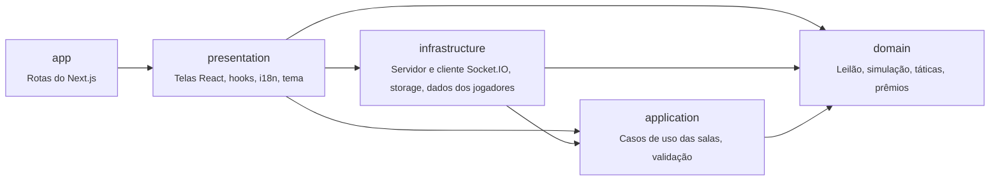

<div align="center">

[English](README.md) · **Português**

# 20 Bucks Each

**Um jogo de leilão de jogadores da NBA em tempo real. Cada um tem $20 para montar o quinteto mais forte.**

### [▶ Jogue agora](https://20-bucks-each.vercel.app)


</div>

<!--
  Prints: coloque as imagens em docs/ e referencie aqui, por exemplo
  
-->

## O que é

Os técnicos entram numa sala, cada um com $20. Os jogadores da NBA vão a leilão um por um, e todo mundo dá lances ao vivo para fechar PG, SG, SF, PF e C. Depois do leilão, cada técnico escolhe a escalação e a tática, e uma temporada e playoffs simulados decidem quem montou o melhor time. Dá para jogar com amigos em salas públicas ou privadas, ou treinar sozinho contra bots.

## Por que eu fiz

Duas coisas me inspiraram. Uma é um formato de vídeo de criadores americanos de esporte: cada um recebe "$20 each", eles leiloam jogadores e discutem quem montou o melhor time. A outra é o [100pracada](https://100pracada.thefenomeno.com/), jogo brasileiro de navegador que faz o mesmo com futebol. Eu queria a versão da NBA, algo para jogar com os amigos, e um projeto de verdade para aprender: multiplayer em tempo real, lógica de jogo, probabilidade e deploy, e não só mais um CRUD.

## Como foi feito, passo a passo

**1. Design antes do código.** Antes de escrever qualquer código, fiz os mockups das três telas principais num canvas de design: criar sala, leilão ao vivo, e temporada e playoffs. Foi aí que a identidade visual se definiu: verde-escuro, a cor do dólar, com a nota de $20 como elemento central. O mascote começou como um urso e virou um **veado macho** bravo, porque "bucks" quer dizer tanto "dólares" quanto "veados machos" em inglês. É um desenho original, feito de propósito para não lembrar nenhum logo de time da NBA.

**2. Um motor de leilão sem interface.** O primeiro código foram as regras do leilão em TypeScript puro: lances, lance máximo (para ninguém ficar sem dinheiro para as vagas abertas), posições, e bots que avaliam jogadores pelo overall, pelo saldo e pelo que falta no elenco. Toda função recebe um estado e devolve outro, com um gerador aleatório com semente. Assim deu para testar leilões inteiros antes de existir qualquer tela.

**3. Os testes de jogo mudaram as regras.** Cada versão foi jogada e ajustada:
- Mostrar os próximos jogadores acabava com a tensão, então a fila ficou escondida.
- O pessoal passava em todo mundo esperando um craque. Agora cada leilão sorteia um pool limitado, e quem termina com vaga aberta leva o *pior* jogador que sobrou.
- O relógio não reinicia mais a cada lance. Um lance nos últimos 3 segundos só volta o relógio para 3.
- Quem não tem vaga ou dinheiro passa automaticamente, com um aviso explicando o motivo, e o lote fecha assim que ninguém mais consegue cobrir o maior lance.
- Modo opcional de **overall escondido**, para os lances dependerem do conhecimento de NBA.
- Jogadores podem atuar uma posição ao lado da deles (ex.: um SG de PG ou SF), perdendo força.

**4. Uma simulação que dá para explicar.** Para decidir os jogos, escolhi um modelo de probabilidade em vez de um modelo de linguagem: é de graça, instantâneo e controlável. Cada jogo é **65% força do time e 35% sorte**: uma curva logística da diferença de força, misturada com uma moeda. A margem do placar é sorteada de uma distribuição normal ajustada para essa mesma probabilidade, então o placar sempre bate com as chances. Um teste com 4.000 jogos confirma que a taxa de vitória segue a fórmula. Em cima disso vieram jogos ao vivo quarto a quarto com lances destacados (quartos quentes, viradas, trocas de liderança), estatísticas completas (arremessos, bolas de 3, lances livres, rebotes, assistências, roubos e tocos) que sempre fecham com o placar, temporada de todos contra todos, chave no estilo da NBA com folgas, séries de 1, 3 ou 7 jogos, MVP, MVP das Finais e outros prêmios.

**5. Multiplayer.** Um servidor Socket.IO controla o relógio, os bots e as regras, e os clientes só mandam intenções (lance, passar, trocar). As salas ganharam:
- salas públicas listadas ao vivo na tela inicial, e privadas por link ou código;
- configurações do dono, botão de pronto e expulsar;
- **modo ausente**: depois de 45 s parado, um bot marca você como pronto, dá lances por você ou escolhe sua tática;
- bot no lugar de quem sai;
- um token secreto no navegador, para recarregar a página sem perder a vaga;
- campeonato assistido junto: a sala inteira avança rodada por rodada; quando os jogos da rodada terminam, todos têm até 10 s para ler e dar pronto (quem está ausente conta como pronto);
- "jogar novamente" leva as mesmas pessoas de volta ao lobby da sala, com as mesmas configurações.

O servidor nunca envia informação escondida: a fila de jogadores, a semente aleatória (o campeonato é simulado passo a passo no servidor, então ninguém consegue prever o próximo jogo), a tática dos outros técnicos e os tokens.

**6. Tática e escalação.** Depois do leilão, cada técnico escolhe um estilo de ataque (equilibrado, chuva de 3, garrafão) e um ritmo (lento, normal, rápido). Cada escolha ajuda ou atrapalha conforme o elenco. As referências são as medianas dos atributos dos times em leilões simulados, então cada estilo é bom para mais ou menos metade dos times. Um editor de escalação permite trocar jogadores entre as posições e o banco. Os dois podem mudar entre um jogo e outro: cada rodada da temporada e cada jogo de uma série de playoffs só é simulado na hora, com a tática e a escalação daquele momento. Nas partidas sem overall, o efeito das táticas também fica escondido.

**7. Acabamento.** Português, inglês e espanhol. Tema claro e escuro sem piscar ao carregar. Diálogos, rótulos e regiões ao vivo acessíveis. Várias rodadas de ajuste de espaçamento vindas do uso real.

**8. Clean Architecture.** Com as funcionalidades prontas, reorganizei o código em `domain → application → infrastructure → presentation → app`. Um [teste automático](src/architecture.test.ts) falha se algum arquivo quebrar a regra de dependência.

**9. Colocando no ar.** O site roda na **Vercel** e o servidor das salas no **Render**. O deploy trouxe aprendizados reais:
- Um `package-lock` desatualizado quebrou a instalação.
- Arquivos que sobraram de uma renomeação quebraram a checagem de tipos.
- Um caractere errado na origem permitida causou bloqueio de CORS.
- O servidor gratuito dorme quando ninguém usa. Agora o site mostra "ligando o servidor…" e reconecta sozinho, em vez de parecer quebrado.

## Arquitetura



| Camada | O que tem lá | Depende de |
| --- | --- | --- |
| `domain` | Motor do leilão, bots, regras de posição e escalação, simulação de jogos e campeonato, táticas, prêmios. TypeScript puro, sem pacotes e sem I/O. | nada |
| `application` | `RoomService`: salas, pronto/expulsar, modo ausente, fases e validação de tudo que vem do navegador. Relógio, aleatoriedade e dados dos jogadores são injetados. | domain |
| `infrastructure` | Adaptador do servidor Socket.IO, cliente do socket, storage do navegador, dados dos jogadores. | application, domain |
| `presentation` | Telas e hooks React, traduções, tema. | todas as internas |
| `app` | Só as rotas do Next.js. | presentation |

```
server/index.ts              Ponto de montagem do servidor das salas
src/
  domain/                    auction/, simulation/, awards/, shared/rng.ts
  application/rooms/         RoomService (casos de uso), DTOs, validação
  infrastructure/            server/, realtime/, storage/, data/players.ts
  presentation/              components/, hooks/, i18n/, theme/
  app/                       Rotas do Next.js (/ e /sala/[code])
  architecture.test.ts       Garante a regra de dependência
```

## Tecnologias

Next.js 16 · React 19 · TypeScript (strict) · Socket.IO 4 · CSS Modules · test runner nativo do Node com tsx · Vercel (site) · Render (servidor das salas)

## Próximos passos

- Base de jogadores real, com fotos e ratings calculados a partir de estatísticas reais
- Bots que arrumam a própria escalação depois do leilão
- Outros esportes
- Salas persistentes e histórico de partidas

## Aviso

Projeto de fã feito para aprendizado. Sem vínculo com a NBA, seus times ou a 2K. Os ratings dos jogadores são estimativas provisórias, não números oficiais.

---

Feito por [cardinalipedro](https://github.com/cardinalipedro). Eu defini as funcionalidades, desenhei a experiência e testei cada versão jogando, com um assistente de IA (Claude) como par de programação para o código e a refatoração.
