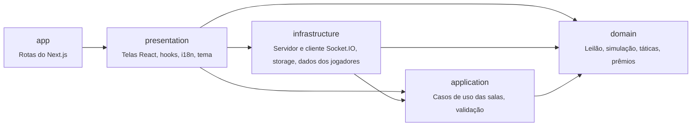

<div align="center">

[English](README.md) · **Português**

# 20 Bucks Each

**Um jogo de leilão de jogadores da NBA em tempo real. Cada um tem $20 para montar o quinteto mais forte.**

Dispute jogadores ao vivo com amigos (ou bots), monte a escalação e a tática, e veja uma temporada e playoffs simulados decidirem quem montou o melhor time.


</div>

<!--
  Prints: coloque as imagens em docs/ e referencie aqui, por exemplo
  
-->

## Sobre

Inspirado nos vídeos de leilão "$20 each" de criadores americanos de esporte e no jogo brasileiro [100pracada](https://100pracada.thefenomeno.com/). Cada técnico começa com $20 e precisa fechar PG, SG, SF, PF e C dando lances em um jogador por vez. Gastar tudo num craque ou espalhar o dinheiro? Depois, a simulação decide.

## Funcionalidades

**Multiplayer**
- Salas públicas (listadas ao vivo na tela inicial) e privadas, compartilhadas por link ou código, de 2 a 16 técnicos.
- Controles do dono: mudar regras e visibilidade, expulsar jogadores e começar quando todos estiverem prontos.
- Vagas vazias completadas com bots. Quem sai da partida é substituído por um bot de vez.
- **Modo ausente**: depois de 45 s sem mexer (ou se a conexão cair), um bot assume. No lobby ele marca você como pronto; no leilão, dá lances por você; na tática, escolhe a que mais combina com o seu elenco. Qualquer movimento devolve o controle.
- Recarregar a página não tira você da sala: o navegador guarda um token secreto que nunca é enviado aos outros jogadores.

**Leilão**
- Um relógio por jogador que não reinicia: um lance nos últimos 3 segundos só volta o relógio para 3.
- Lance máximo controlado, para ninguém ficar sem $1 para cada vaga aberta.
- Pool de jogadores limitado e aleatório (vagas + 30%, todas as posições garantidas). Esperar um craque é arriscado: quem termina com vaga aberta leva o pior jogador que sobrou.
- Passe automático, com o motivo na tela, quando falta vaga ou dinheiro. O lote fecha assim que ninguém mais consegue cobrir o maior lance.
- Modo opcional de **overall escondido**: sem overall nem atributos, só o seu conhecimento de NBA.
- Jogadores podem ser escalados numa posição vizinha (PG↔SG↔SF↔PF↔C), perdendo um pouco de força.

**Simulação**
- Cada jogo é 65% força do time e 35% sorte: zebras acontecem, mas o melhor time continua favorito.
- Estatísticas realistas: placar por quarto, prorrogação, e pontos, rebotes e assistências distribuídos entre os jogadores pelos atributos.
- Temporada regular todos contra todos, chave no estilo da NBA com folgas, séries de 1, 3 ou 7 jogos com mando 2-2-1-1-1.
- **Táticas**: estilo de ataque (equilibrado, chuva de 3, garrafão) e ritmo (lento, normal, rápido). Cada uma ajuda ou atrapalha conforme o encaixe com o elenco. As táticas ficam secretas até os jogos.
- **Editor de escalação**: troca jogadores entre as posições e o banco.
- Prêmios: campeão, MVP, melhor GM (mais valor por dólar) e maior compra.

**Interface**
- Português, inglês e espanhol, detectados automaticamente e alternáveis.
- Tema claro e escuro, sem piscar ao carregar.
- Responsiva e acessível: botões e formulários semânticos, rótulos, regiões ao vivo para relógios e placares, e diálogos com controle de foco.

## Arquitetura

O código segue **Clean Architecture**. As dependências só apontam para dentro, e um [teste automático](src/architecture.test.ts) falha se algum arquivo quebrar essa regra.



| Camada | O que tem lá | Depende de |
| --- | --- | --- |
| `domain` | Motor do leilão, bots, regras de posição e escalação, simulação de jogos e campeonato, táticas, prêmios. TypeScript puro, sem pacotes e sem I/O. | nada |
| `application` | `RoomService`: salas, pronto/expulsar, modo ausente e fases, além da validação de tudo que vem do navegador. Relógio, aleatoriedade e base de jogadores são injetados. | domain |
| `infrastructure` | Adaptador do servidor Socket.IO, cliente do socket, storage do navegador, dados dos jogadores. | application, domain |
| `presentation` | Telas e hooks React, traduções e tema. | todas as internas |
| `app` | Só as rotas do Next.js. | presentation |

### Decisões de projeto

- **Motor puro e determinístico.** Toda função do leilão e da simulação recebe um estado e devolve outro. A semente do gerador aleatório fica dentro do estado, então a mesma semente sempre repete a mesma partida. Isso deixa as regras fáceis de testar e permite rodar exatamente o mesmo código no navegador (modo treino) e no servidor (salas).
- **O servidor decide.** É o servidor que controla o relógio, os bots e as regras. Os clientes só enviam intenções (lance, passar, trocar) e recebem visões prontas. Todo dado recebido é validado antes de ser usado.
- **Informação escondida continua escondida.** Os clientes nunca recebem a fila dos próximos jogadores, a semente aleatória, a tática dos outros técnicos nem o token dos outros jogadores. Os testes conferem isso.
- **Probabilidades que dá para explicar.** A chance de vitória mistura uma curva logística da diferença de força (65%) com uma moeda (35%). A margem do placar é sorteada de uma distribuição normal cuja média vem da inversa da normal acumulada dessa chance, então o placar sempre bate com as probabilidades. Um teste com 4.000 jogos confirma que a taxa de vitória observada segue a fórmula.
- **Táticas calibradas com dados.** As referências de encaixe são as medianas dos atributos dos times em leilões simulados, então cada estilo ajuda mais ou menos metade dos elencos e atrapalha a outra metade.

## Como rodar

Requisitos: Node.js 20.9+

```bash
npm install
npm run dev
```

O `npm run dev` sobe o site (http://localhost:3000) e o servidor das salas (porta 3001) juntos. Para testar o multiplayer no seu computador, abra o site numa janela normal e numa anônima, crie a sala numa e entre pela outra.

| Script | O que faz |
| --- | --- |
| `npm run dev` | Site + servidor das salas com recarga automática |
| `npm test` | Testes do motor, da simulação, das salas e da arquitetura |
| `npm run typecheck` | Checagem do TypeScript em modo strict |
| `npm run build` | Build de produção do site |
| `npm run start:server` | Servidor das salas em produção |

### Publicar online

O site e o servidor das salas rodam separados:

1. **Servidor das salas**: qualquer hospedagem que mantenha um processo Node.js rodando (Render, Railway, Fly.io…). Comando de início `npm run start:server`, com a variável `CLIENT_ORIGIN` apontando para o endereço do site.
2. **Site** na Vercel, com a variável `NEXT_PUBLIC_SERVER_URL` apontando para o servidor das salas.

Sem o servidor, o site continua funcionando no modo treino contra bots.

## Estrutura do projeto

```
server/index.ts              Ponto de montagem do servidor das salas
src/
  domain/
    auction/                 Motor, regras, bots, pool, posições, escalação
    simulation/              Probabilidade, jogos, campeonato, táticas, força do time
    awards/                  Melhor GM, maior compra, rankings
    shared/rng.ts            Gerador aleatório com semente
  application/rooms/         RoomService (casos de uso), DTOs, validação
  infrastructure/
    server/                  Adaptador Socket.IO
    realtime/                Cliente do socket e nomes dos eventos
    storage/                 Identidade no navegador (token, nome)
    data/players.ts          Base de jogadores
  presentation/
    components/              Telas: início, leilão, tática, campeonato, salas
    hooks/                   useAuction, useRoom, usePublicRooms, useConnection
    i18n/                    Textos em PT / EN / ES
    theme/                   Tema claro / escuro
  app/                       Rotas do Next.js (/ e /sala/[code])
  architecture.test.ts       Garante a regra de dependência
```

## Próximos passos

- Base de jogadores real, com fotos e ratings calculados a partir de estatísticas reais
- Bots que arrumam a própria escalação depois do leilão
- Outros esportes (o motor só depende das posições do basquete em `domain/auction/positions.ts`)
- Salas persistentes e histórico de partidas

## Aviso

Projeto de fã feito para aprendizado. Sem vínculo com a NBA, seus times ou a 2K. Os ratings em `src/infrastructure/data/players.ts` são estimativas provisórias, não números oficiais.

---

Feito por [cardinalipedro](https://github.com/cardinalipedro).
